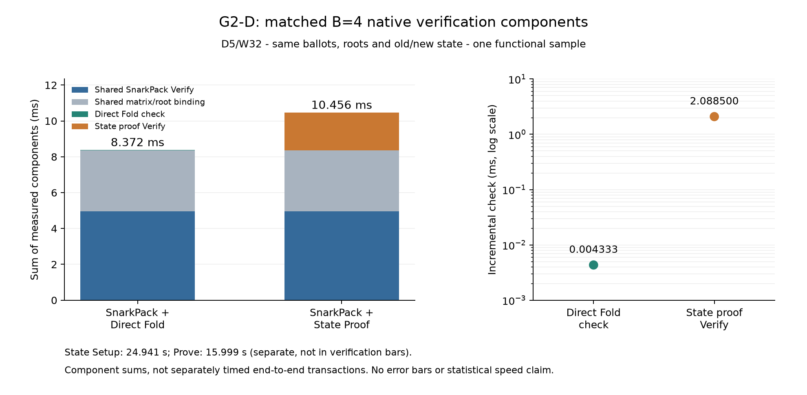
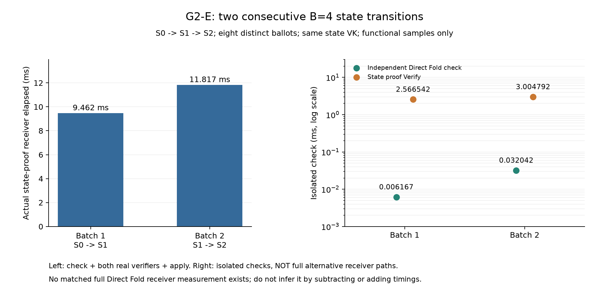

# 第一阶段：已有实测数据对比

这是对归档数据的只读分析；没有新执行 Setup、Prove、重型验证或性能采样。

## G1-E：复用原六组统计图

M4 / D5 / W32，同一证明池；每规模 30 个串行操作样本，非 30 次独立选举。
比例是逐轮配对比值的中位数，不是两组中位数相除。区间为原条件 bootstrap 区间。

| B | 逐票 Verify ms | 聚合 Verify ms | 聚合生成 ms | 配对验证比 [95% CI] | 原证明 bytes | 聚合证明 bytes |
|---|---:|---:|---:|---|---:|---:|
| 2 | 0.967169 | 3.128145 | 4.360998 | 0.302 [0.300, 0.307] | 384 | 5236 |
| 4 | 1.901342 | 4.091989 | 8.782294 | 0.481 [0.440, 0.504] | 768 | 8212 |
| 8 | 3.944255 | 4.830629 | 16.769415 | 0.816 [0.768, 0.834] | 1536 | 11188 |
| 16 | 7.134917 | 5.522694 | 30.857372 | 1.402 [1.376, 1.432] | 3072 | 14164 |
| 32 | 15.446558 | 6.480822 | 52.507146 | 2.461 [2.373, 2.543] | 6144 | 17140 |

B16/B32 在本机固定池有验证者收益；不代表总计算、通信或链上收益。
B32 聚合+验证中位数 58.772 ms；原证明+一份公开矩阵 31,744 B，聚合+同一矩阵 42,740 B。
矩阵已经包含密文；可导出的 transcript 不再算成必传的第二份数据。
内存图是预热后操作阶段的 1 ms 采样峰值（3 进程 min/max），不可与 G2 的含 Setup/Prove 累计 RSS 排名。

- [原统计图：fig1_verification](../g1_e/figures/fig1_verification.pdf)（PDF；同目录有 PNG/SVG，原字节保留）
- [原统计图：fig2_per_vote](../g1_e/figures/fig2_per_vote.pdf)（PDF；同目录有 PNG/SVG，原字节保留）
- [原统计图：fig3_speed_ratio](../g1_e/figures/fig3_speed_ratio.pdf)（PDF；同目录有 PNG/SVG，原字节保留）
- [原统计图：fig4_proof_communication](../g1_e/figures/fig4_proof_communication.pdf)（PDF；同目录有 PNG/SVG，原字节保留）
- [原统计图：fig5_memory](../g1_e/figures/fig5_memory.pdf)（PDF；同目录有 PNG/SVG，原字节保留）
- [原统计图：fig6_aggregation](../g1_e/figures/fig6_aggregation.pdf)（PDF；同目录有 PNG/SVG，原字节保留）

## G2-D：同一批 B4 的匹配组件口径

| 组件 | ms |
|---|---:|
| 两路相同的 SnarkPack Verify | 4.951792 |
| 两路相同的矩阵/根绑定 | 3.416083 |
| Direct Fold 增量检查 | 0.004333 |
| State Proof Verify | 2.088500 |
| Direct Fold 路线组件和 | 8.372208 |
| State Proof 路线组件和 | 10.456375 |

组件和不是单独计时的端到端事务；这是一个功能样本，没有置信区间。Direct Fold 是有效的正确性基线。
State Setup 24.941019 s / Prove 15.998831 s，单独记账。
State proof 192 B / public inputs 1184 B；不能把两者之和当完整通信量。

## G2-E：连续状态转换，不伪造完整替代基线

| 批次 | SP Verify ms | State Verify ms | 实际接收检查/验证/应用 ms | 独立直接累计检查 ms |
|---|---:|---:|---:|---:|
| 1 | 6.842292 | 2.566542 | 9.462042 | 0.006167 |
| 2 | 8.751791 | 3.004792 | 11.817333 | 0.032042 |

后两列不是两条完整路线的公平计时，不能相除作为系统加速比。没有额外测量共同接收开销，故不补算 Direct Fold 完整接收时间。
两批各四票，第二批旧状态非零；最终密文等于独立累计八票。不是 B8 状态电路。
重建 Setup 25.314304 s；只新增第二批 State Prove 16.917431 s。
复用首批状态证明和八份选票证明；不能声称本轮新生成所有证明。

## 暂不生成的对比

- Full Tally vs Winner-only：等待同一冻结目标的完整原生状态机。
- 完整链上 Gas、calldata、端到端系统图：等待正确新 VK 的真实结算路线。缺失为 null，不是 0。
- 跨论文性能排名、额外规模、重复 G1-E、底层 Miller 优化：本轮不做。

G4-D 已有同一新电路/VK 的十种 Trustee 子集真实证明，不重做；下一实现仍是完整原生 Winner-only 连接。
